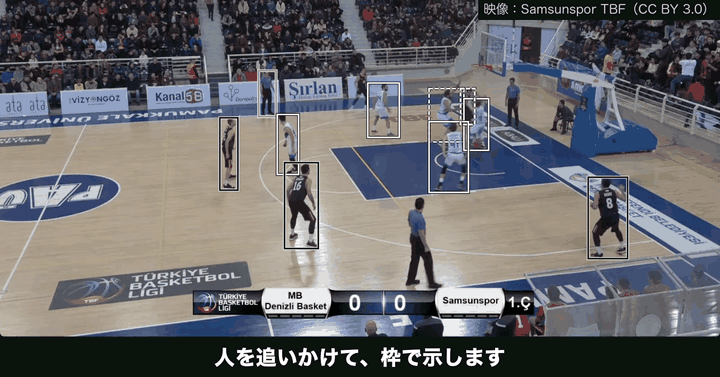
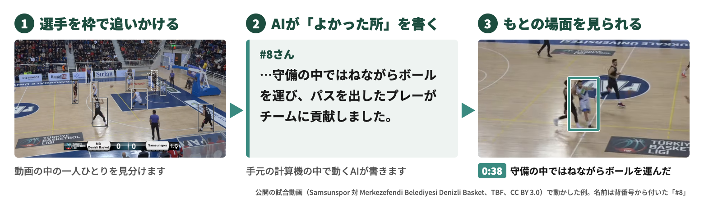
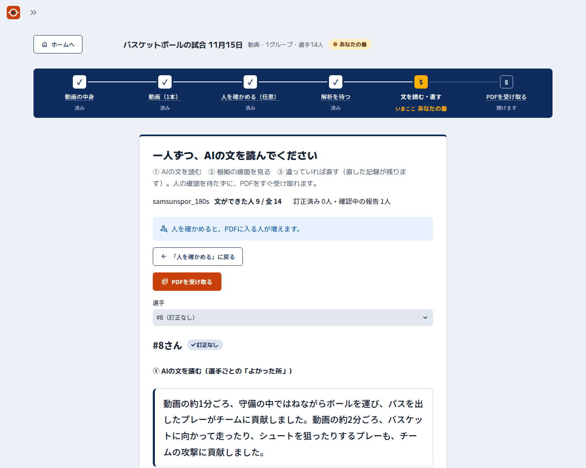
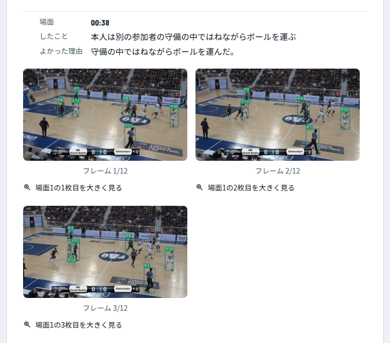
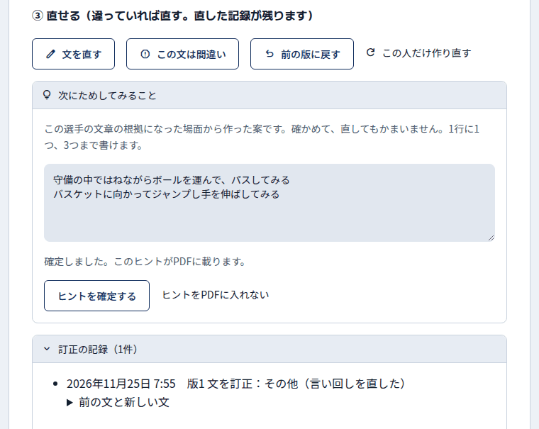
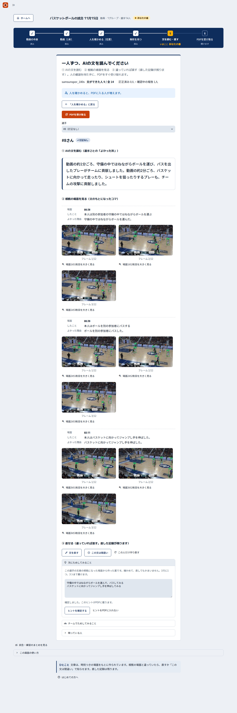
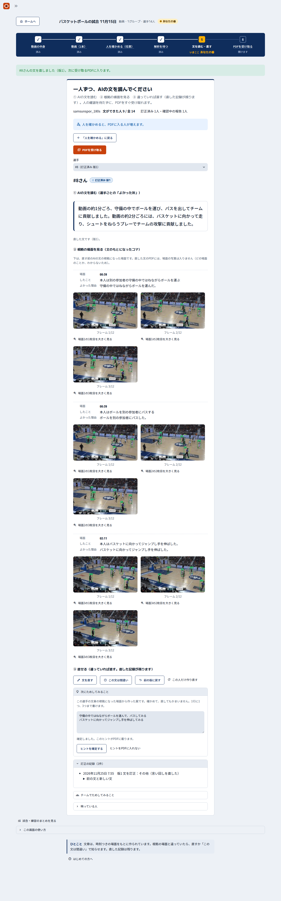
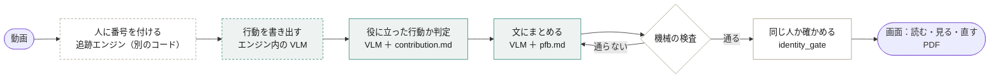

<p align="center">
  
</p>

<p align="center">
  <b>グループ活動や試合の動画から、一人ひとりの「よかった所」を、根拠の場面つきの文にする</b><br>
  手元の計算機だけで動くローカルVLMアプリ
</p>

<p align="center">
  <a href="LICENSE"></a>
  
  
  
</p>

<p align="center">日本語 | <a href="#english">English</a></p>

<p align="center">
  
</p>
<p align="center"><sub>公開の試合動画（TBF、CC BY 3.0）で NiceMill を動かした様子。一人ひとりを枠で追いかけ、その人の「よかった所」を文にします。</sub></p>

---

## NiceMill とは

グループ活動や試合のあとに、一人ひとりへ「今日のよかった所」を伝えたい。けれど、全員分の動画を見返すのは大変です。
NiceMill は、動画をローカルの VLM（画像と言葉を扱う AI）に見せて、選手（参加者）ごとの
ポジティブ・フィードバック（よかった所を伝える文）を作ります。

<p align="center"></p>

| 特徴 | 内容 |
|---|---|
| **動画を外に出さない** | 解析も文づくりも手元の計算機の中で行います。クラウドの AI サービスは使いません。 |
| **根拠の場面が付く** | 文ごとに、もとになった動画の場面（その人を枠で囲んだコマ）を見られます。 |
| **あとから直せる** | 違っていれば、その場で直せます。前の文は消さず、だれが・いつ・どう直したかが残ります。 |
| **よかった所だけ** | 肯定的な内容だけを書きます。順位づけや、ほかの人との比較はしません。 |

> [!NOTE]
> 研究・試作の段階のソフトです。教育や競技の現場に導入済みという意味ではありません。
> このリポジトリはアプリ本体（画面、ワーカー、文づくりと検査、PDF の出力）とテストで、**人物の追跡を行うエンジンは含みません**。
> このリポジトリだけで動かせるのは、画面とテスト（合成データ）までです（[限界](#限界)の1）。

### 目次

- [関連する発表](#関連する発表)
- [使い方の流れ](#使い方の流れ)
- [仕組み](#仕組み)
- [出力](#出力)
- [すぐ試す（データなし）](#すぐ試すデータなし)
- [テストの結果](#テストの結果)
- [この公開版に入っているもの](#この公開版に入っているもの)
- [リポジトリの構成](#リポジトリの構成)
- [限界](#限界)
- [プライバシーとデータの扱い](#プライバシーとデータの扱い)
- [ライセンス](#ライセンス)・[出典](#出典画像動画)・[引用](#引用)

## 関連する発表

- 題目：ローカルVLMを用いた協働インタラクション動画からのポジティブ・フィードバック生成
- 著者：濱田 怜央，酒造 正樹（湘南工科大学）
- 第17回対話システムシンポジウム ポスター No.37

## 使い方の流れ

画面は6つのステップで進みます。

| 1 | 2 | 3 | 4 | 5 | 6 |
|---|---|---|---|---|---|
| 動画の中身 | 動画を入れる | 人を確かめる（任意） | 解析を待つ | **文を読む・直す** | PDF を受け取る |
| 活動の種類・出典 | 動画ファイル | 名前や背番号と人を結ぶ | エンジンと AI が処理 | ① 読む ② 見る ③ 直す | 1人1ページ |

画面から作る新しい作業は、文の出し方「**あとから訂正**」で始まります。人の確認を待たずに PDF を受け取れて、
違っていた所はあとから直せます。作業の設定で、出す前に人が一人ずつ確かめる出し方に切りかえることもできます。

### ① AI の文を読む



選手を選ぶと、その人の「よかった所」を伝える文が出ます。文は、追跡した人物ごとの行動の記録から作ります。
人ごとの確認状況（訂正なし／訂正済み 版N／誤りの報告あり・確認中）と、文ができた人数も出ます。

### ② 根拠の場面を見る



文ごとに、もとになった場面を「時刻・したこと・よかった理由」と一緒に見られます。
コマには、追跡した人に番号（P1…）と枠が描いてあります。文が言っていることを、映像で確かめられます。

### ③ 直す



| ボタン | すること |
|---|---|
| 文を直す | 文を書き直します（理由とメモは任意）。直した文は新しい版になります。 |
| この文は間違い | 理由（人物の取り違え、動作が違う、背番号が違う、その他）を選んで知らせます。確かめたら「確認して報告を閉じる」で閉じます。 |
| 前の版に戻す | 直す前の文に戻します。 |
| この人だけ作り直す | その人の文だけを AI が作り直します。 |

どの操作も記録に追記するだけで、前の文は消しません（`src/pfb_app/services/corrections.py`）。
PDF を受け取ったあとで、PDF に入っている人の文や確認状況が変わったときは、画面に「再出力が必要」と出ます。

<details>
<summary>画面の全体（直す前と、1回直したあと）</summary>

| 直す前 | 1回直したあと（訂正済み 版1） |
|---|---|
|  |  |

</details>

## 仕組み



<sub>緑の箱＝VLM（Qwen3-VL など）に指示文（`prompts/`）を入れて答えさせる段。白の箱＝プログラムの段。点線＝このリポジトリに含まないエンジンの中で行う段。</sub>

1. **人に番号を付ける**：エンジンが人物を追跡し、匿名のラベル（P1…Pn）を付けます。
2. **行動を書き出す**：エンジンが、時間の窓ごとの画像に番号と枠を描き、VLM に「この番号の人が何をしたか」だけを聞きます。
   人物の特定は追跡で固定し、AI に人を当てさせません。アプリはその記録を受け取って次の段に渡します（`src/pfb_app/pipeline/pfb3x3_bridge.py`）。
   追跡を使わない作業では、アプリが VLM で人を対応づけてから、指示文（`prompts/video/identity.md`、`behavior.md`）で行動を書き出します。
3. **役に立った行動か判定する**：行動ごとに、グループへの貢献になったかを判定させます。
4. **文にまとめる**：役に立ったと判定された行動だけを根拠にして、1人分の文を作ります。根拠がなければ AI を呼ばず、文を作りません。
5. **機械の検査**：根拠の ID が実在しないときや、時刻の言い方が合わないときは作り直します。
   内部のラベルやカメラ名が文に出ていれば、警告を付けます（`src/pfb_app/pipeline/checks.py`）。
6. **同じ人か確かめる**：「あとから訂正」の作業で PDF に載せるのは、背番号の読み取りか「人を確かめる」で、同じ人だと確かめられた人だけです。
   作業の中に確かめる手がかりが1人分もないときは、全員を「同じ人かどうかは確かめていない」と書いて載せます（`docs/identity_gate.md`）。

AI が読んだ背番号は「背番号 3番？（推定）」のように推定として出し、確信が足りない動作の言い切りは弱めて「要確認」を付けます。
音声がある動画では、faster-whisper で文字にして、行動の記録の手がかりにします。

| 段 | 役目 | 主なコード |
|---|---|---|
| 画面 | 登録、文と根拠の確認、直す、PDF | `src/pfb_app/ui/` |
| ワーカー | ジョブの実行、GPU の空きの監視 | `src/pfb_app/worker/` |
| 追跡・背番号・行動の記録 | 別のエンジンをサブプロセスで呼ぶ | `src/pfb_app/engine/` |
| 行動・貢献・文・検査 | VLM への問い合わせと検査 | `src/pfb_app/pipeline/` |
| 推論 | localhost の VLM サーバーだけに問い合わせる | `src/pfb_app/inference/` |
| 直した記録 | 文の版と記録 | `src/pfb_app/services/corrections.py` |
| PDF・冊子 | 1人1ページの PDF、製本用の冊子 | `src/pfb_app/export/` |
| 振り返りプレーヤー | 根拠の場面を人ごとに見返す | `src/pfb_app/review_video/` |

## 出力

- **1人1ページの PDF**（A4）：文、根拠の場面の写真、時間の流れ、場面の種類のグラフ（あれば、練習のヒント）。
  ページには、AI が作った文であること、人の確認を経ていない場合があること、誤りがあれば直せることと、
  確認状況・訂正の記録・文の版を書きます。載らない人は、理由と一緒に画面に出ます。
- **製本用の冊子の PDF**：A4 の冊子で、1人を見開きの2ページに載せます。A3 に2面ずつ並べた中綴じ用の PDF も作れます。
  いまは画面のボタンはなく、`pfb_app.export.booklet.build` と `impose_a3` で作ります（`docs/booklet.md`）。
- **振り返りプレーヤーとハイライト動画**：根拠の場面を人ごとに見返せる HTML と動画です（`docs/review_video.md`）。

## すぐ試す（データなし）

Python 3.10 が要ります。GPU もモデルも動画も要りません。

```bash
git clone https://github.com/hamadareo/NiceMill.git && cd NiceMill
python3.10 -m venv .venv && . .venv/bin/activate
pip install -r requirements-test.txt     # テストと画面を動かすための軽い依存だけ
pytest -q                                # 自作の合成データだけを使います
```

> [!IMPORTANT]
> PDF を作る WeasyPrint には Pango のライブラリが要ります（Linux：`libpango-1.0-0`、macOS：`brew install pango`）。
> 無いと、多くのテストが読み込みの段階で止まります。

**画面だけを起動して見る**

```bash
printf 'data_dir: ./data\ninbox_dir: ./inbox\nauth_enabled: false\n' > /tmp/nicemill.yaml
PYTHONPATH=src PFB_CONFIG=/tmp/nicemill.yaml streamlit run src/pfb_app/ui/serve.py \
  --server.address 127.0.0.1 --server.port 8501
```

ブラウザで `http://127.0.0.1:8501` を開くと、ホームと登録の画面が開きます。

- `auth_enabled: false` は、ログインなしで使う、手元での確認用の設定です。上の起動は 127.0.0.1 だけで待ち受けるので、
  この計算機からしか開けません（ログインなしの画面は、外部のプロキシやトンネルを通った要求には出ません。`src/pfb_app/ui/open_guard.py`）。
- 複数の人で使うときは、`docs/accounts.md` を読んで、ログインを有効にしてください。
- 設定の例：`config/settings.example.yaml`。

**フルの構成**（GPU、vLLM、PyTorch、エンジン）の依存は `pyproject.toml` にあります（`uv sync`。CUDA 12.9 向けの PyTorch と vLLM）。
動画から文までを通すにはエンジンが要り、このリポジトリには含まれません（`docs/pfb3x3_engine.md`）。
試す素材は、公開の動画だけにしてください（[出典](#出典画像動画)）。動画は Git に入れないでください（`.gitignore` で除いています）。

## テストの結果

この公開版のツリーそのもので、全部のテストを動かした結果です。

| 項目 | 値 |
|---|---|
| 日付 | 2026-11-25 |
| 環境 | Ubuntu 24.04、Python 3.10.20（GPU・モデル・動画は使わない） |
| 結果 | 3,503 件が通過、3 件はスキップ、失敗 0 件（約22分） |

- 全体の実行のあとで、文書の見出しとコードのコメントの言い回しを直しました。関係するテストのファイル（142件）を再実行して、通ることを確かめています。
- 一時ファイルは、ディスクの空きが十分な場所に置いてください。動画の受け取りのテストは、空きが少ないと受け取りを断る動きになり、失敗します。

## この公開版に入っているもの

研究室内の開発版のコードから、接続先や内部のメモなどを取り除いて作りました。

**入っているもの**：動画の登録、人物の確認、解析（エンジンの呼び出し）、文と根拠の確認と直す仕組み、
1人1ページの PDF と製本用の冊子、やさしい文章版、練習のヒント、振り返りプレーヤーとハイライト動画、
動作の確認（`claim_check`）、名前のない検出の枠（`extra_boxes`）、運用（バックアップ・監視）、アカウント。

**入っていないもの**：

- 人物の追跡・背番号・行動の記録を行うエンジン（別のコード。未公開）
- 姿勢・ボール検出・動作の確認の手がかりを作る道具（AGPL-3.0 の ultralytics に依存するため）
- 動画、データベース、評価の結果、モデルの重み
- 研究室の機器とデータに依存する、結合テストと計測のスクリプト

## リポジトリの構成

```text
NiceMill/
├── src/pfb_app/            アプリ本体（ui, worker, pipeline, inference, export, review_video, services, storage …）
├── prompts/                VLM への指示文（活動の種類ごと：video, video_sports, video_meeting …）
├── tests/                  テスト（合成データと、偽のエンジン tests/fakes/fake_engine.py）
├── docs/                   設計と使い方（日本語）。docs/user_guide.md から読むのがおすすめ
├── config/                 設定の例
├── scripts/                運用とエンジンの準備のスクリプト
├── LICENSE, NOTICE         Apache License 2.0
└── THIRD_PARTY_NOTICES.md  依存ライブラリ・モデル・フォントのライセンス
```

## 限界

1. **動画から文までを通して動かすには、別のエンジンが要ります**（未公開）。このリポジトリだけで確かめられるのは、
   画面の起動、テスト（エンジンの代わりに偽物の `tests/fakes/fake_engine.py` を使う）、各部品の動きまでです。
2. **文の正しさの定量的な評価は、これからです**。パス・シュートなどが本当に起きたかは、少数の手採点で調べただけです。
3. **背番号の読み取りは、推定として表示します**（「N番？（推定）」）。読み取りの精度の検証は、これからです。
4. **「あとから訂正」では、文は人が見る前に出力に入ります**。違っていれば、あとから直します。出力には、AI が作った文であることと、
   直せることを書きます。
5. **動作の確認**（`claim_check`）は5種類の動作（シュート・ドリブル・パス・守り・走る）に限られ、
   正しい文を残す率は測っていません。姿勢の手がかりを作る道具は含まれないため、別に用意しないと、シュートなどの確認はできません。
6. **人物の取り違え**：追跡は、カメラの切り替えや混雑で、別の人に移ることがあります。
   「別の人かも」の印がないことは、別人でないという意味ではありません。取り違えの起きる率の全体は測っていません。
7. **名前のない検出の枠**（`extra_boxes`）は、描画の上で人物を補うためのもので、文の根拠にはなりません。
8. **評価の規模は小さく**、公開クリップでの確認が中心です。ほかの会場・カメラ・競技への一般化と、
   使う人の判断への効果（利用者研究）は、これからです。
9. **再現性**：温度 0 でも、vLLM の連続バッチ処理のため、出力は完全には再現されません。
10. **やさしい文章版**の検査は、機械による検査だけです。
11. 撮影・研究利用の同意と、倫理審査の状況は、**現在確認中**です。この文書は、それらが済んでいるとは述べていません。

## プライバシーとデータの扱い

- 動画・画像・データベース・作った文は、すべて使う人の計算機の中に置かれます。このリポジトリには含まれません。
- クラウドの生成 AI の API は使いません。VLM への問い合わせは同じ計算機（localhost）の宛先にだけ送り
  （`src/pfb_app/inference/served.py`）、モデルのライブラリはダウンロードや利用状況の送信をしない設定で動かします（`src/pfb_app/ops/offline.py`）。
- 人物には匿名のラベルを付けます。名簿に名前を入れるかどうかは、使う人が決めます。
- 他人が写る動画を扱うときは、撮影・利用の同意と、所属機関の規則に従ってください。同意の記録を残す欄が画面にあります（任意）。
- バグの報告や質問に、動画・画像・人名を添えないでください。

## ライセンス

- このリポジトリのライセンスは **Apache License 2.0** です（`LICENSE`、`NOTICE`）。著作権者は濱田怜央です。
- `docs/images/` の画像は、元の動画のライセンス（CC BY 3.0）に従います（[出典](#出典画像動画)）。
- フォント（`src/pfb_app/ui/static/fonts/`：M PLUS 1、Dela Gothic One、Barlow Condensed）は SIL Open Font License 1.1 です
  （`src/pfb_app/ui/static/fonts/OFL.txt`）。
- 依存ライブラリとモデルの重みのライセンスは、`THIRD_PARTY_NOTICES.md` と `docs/THIRD_PARTY.md` にあります。
  エンジンが使う Ultralytics（YOLO11）は AGPL-3.0 で、このリポジトリのコードはそれを import しません。

## 出典（画像・動画）

- 試すときの素材は、公開のクリップだけにしてください。
  - Merkezefendi Belediyesi Denizli Basket - Samsunspor (24.01.20)（TBF、Wikimedia Commons、[CC BY 3.0](https://creativecommons.org/licenses/by/3.0/)）
  - 車いすバスケットボールの動画（Splash tv、Wikimedia Commons、[CC BY-SA 4.0](https://creativecommons.org/licenses/by-sa/4.0/)）
- `docs/images/` の画像は、上の1本目のクリップ（約3分の部分）を NiceMill で解析した作業の画面です（CC BY 3.0、作者 TBF、改変あり：
  コマを切り出し、追跡の枠と番号、画面の文字を重ねたもの）。`readme_step5_*.png` は、その画面の一部を切り出したものです。
  `readme_demo.gif` は、同じクリップで NiceMill の追跡の枠を表示した画面を録画したもので、`readme_overview.png` は、同じクリップの映像と画面の文から組んだ説明の図です。
  名前は、NiceMill が背番号の読み取りから付けた「#8」などで、実名は入っていません。文は AI が作ったもので、
  「1回直したあと」の画面は、説明のために一度言い回しを直したものです。
- `docs/court_reg/samsunspor_tbf.json` は、上の1本目のクリップの上で測ったコートの登録です。
- 画面や動画の例を載せるときは、出典（作者・ライセンス・変更の有無）を添えてください。

## 引用

`CITATION.cff` を参照してください（論文の掲載先は未定です）。

> 濱田 怜央，酒造 正樹：ローカルVLMを用いた協働インタラクション動画からのポジティブ・フィードバック生成，
> 第17回対話システムシンポジウム ポスター No.37，湘南工科大学.

---

<a id="english"></a>

# English

**NiceMill** turns videos of group activities and games into short positive-feedback texts, one per person, each with
the video scenes it is based on. It runs a vision-language model (VLM) on your own machine; videos are never sent to
external services. The animation at the top shows NiceMill tracking each player in a public game video.

| Feature | What it means |
|---|---|
| **Videos stay local** | Analysis and text generation run on local machines only. No cloud AI services. |
| **Evidence scenes** | Every text links to the scenes it came from (frames with the person boxed). |
| **Correct afterwards** | A wrong text can be corrected on the spot. Earlier texts are kept, with who changed what and when. |
| **Positive only** | No ranking and no comparison between people. |

> [!NOTE]
> Research prototype; it has not been introduced in schools or sports settings. This repository holds the application
> (screens, worker, text generation and checks, PDF output) and its tests. **The tracking engine is not included**, so
> this repository alone runs the screens and the tests (synthetic data) only.

### Related presentation

- Title: Positive Feedback Generation from Collaborative Interaction Videos Using Local Vision-Language Models
  (Japanese title: ローカルVLMを用いた協働インタラクション動画からのポジティブ・フィードバック生成)
- Authors: Reo Hamada (濱田 怜央), Masaki Shuzo (酒造 正樹), Shonan Institute of Technology
- Poster No. 37, the 17th Dialogue System Symposium

### Workflow

The screens go through six steps: what the video is about → add the video → check people (optional) → wait for the
analysis → **read and correct** → take the PDF. New works start in the output mode "correct later": the PDF can be
taken without waiting for a person's check, and wrong texts are corrected afterwards. The work settings can switch to a
mode where a person checks each text before output. Step 5 (pictures in the Japanese section) has three parts:

1. **Read the AI's text.** Each player gets a text about what they did well, with a status per person
   (no correction / corrected, version N / error reported, being checked).
2. **See the evidence scenes.** Each text shows its scenes with the time, what the person did and why it helped.
3. **Correct it.** Edit the text, report it as wrong with a reason (wrong person, wrong action, wrong jersey number,
   other), go back to an earlier version, or make the text again for that person only. Every action is appended to a
   record (`src/pfb_app/services/corrections.py`); the screen says when a PDF taken earlier needs to be output again.

### How it works

1. **Number the people**: the engine tracks people and gives them anonymous labels (P1...Pn).
2. **Write down actions**: inside the engine, window images are drawn with numbers and boxes, and the VLM is asked only
   what person N did. Identity is fixed by tracking; the AI is never asked who someone is. The app takes over that record
   (`src/pfb_app/pipeline/pfb3x3_bridge.py`). Works without tracking use the app's own prompts (`prompts/video/identity.md`,
   `behavior.md`) to match people and write down actions.
3. **Judge contributions**: for each action, the VLM judges whether it helped the group.
4. **Write the text**: only actions judged helpful are used as evidence. With no evidence, no AI call is made and no
   text is written.
5. **Mechanical checks**: an output whose evidence ids do not exist or whose time words do not match is generated again;
   internal labels or camera names in a text add a warning (`src/pfb_app/pipeline/checks.py`).
6. **Same-person check**: in "correct later" works, only people confirmed by jersey-number reading or in the people step
   are printed; when a work has no such clue for anyone, everyone is printed with a note that identity was not checked
   (`docs/identity_gate.md`).

Jersey numbers read by the AI are shown as estimates (「背番号 3番？（推定）」), and action sentences without enough
support are weakened and marked 「要確認」 (needs checking). Speech is transcribed with faster-whisper. Prompts are in
`prompts/`, design notes in `docs/` (in Japanese).

### Output

A **one-page-per-person PDF** (A4: the text, pictures of the evidence scenes, a timeline, a chart of the kinds of scenes;
each page says the text was written by AI, may not have been read by a person yet and can be corrected, with the status,
the correction record and the text version); a **booklet PDF for binding** (one spread per person, with an A3
saddle-stitch imposition; made from Python with `pfb_app.export.booklet.build` and `impose_a3`); and a **review player**
with highlight videos (`docs/review_video.md`).

### Quick start (no data)

Python 3.10 is required. No GPU, model or video is needed.

```bash
git clone https://github.com/hamadareo/NiceMill.git && cd NiceMill
python3.10 -m venv .venv && . .venv/bin/activate
pip install -r requirements-test.txt
pytest -q                      # synthetic data only
```

WeasyPrint needs the Pango library (Linux: `libpango-1.0-0`; macOS: `brew install pango`). To start only the screens,
use the `streamlit run` command in the Japanese section (`auth_enabled: false` is for local checks only, and the screens
listen on 127.0.0.1). The full stack (GPU, vLLM, PyTorch, engine) is listed in `pyproject.toml`; running a video end to
end needs the engine, which is not part of this repository. For trials use public clips only, and never commit videos.

### Test results

On this public tree, 2026-11-25, Ubuntu 24.04, Python 3.10.20, no GPU: **3,503 passed, 3 skipped, 0 failed** (about
22 minutes). After the full run, the wording of a document heading and of some code comments was changed; the related test files
(142 tests) were run again and passed. Keep temporary files on a disk with enough free space:
the upload tests expect uploads to be refused when space is low.

### What this snapshot contains

Made from the lab's development version, with addresses and internal notes removed.

- **Included**: video registration, people check, analysis (calling the engine), reading and correcting texts with their
  evidence, the one-page-per-person PDF and the booklet, a plain-language version, practice tips, the review player and
  highlight videos, the action check (`claim_check`), boxes for unnamed detections (`extra_boxes`), operations (backup,
  monitoring), accounts.
- **Not included**: the tracking/jersey/action-record engine (separate, unpublished); the tools that make pose, ball and
  action-check cue files (they depend on AGPL-3.0 ultralytics); videos, databases, evaluation results, model weights;
  integration and benchmark scripts that depend on the lab's machines and data.

### Limitations

1. Running a video end to end needs the separate engine (unpublished); this repository alone covers the screens, the
   tests (with a fake engine, `tests/fakes/fake_engine.py`) and the parts.
2. A quantitative evaluation of the correctness of the texts is still to come; only a small hand-scored sample exists.
3. Jersey numbers read by the AI are shown as estimates; validating the reading accuracy is still to come.
4. In "correct later" mode, texts go into the output before a person has read them; a wrong text is corrected
   afterwards. The output says that the text was written by AI and can be corrected.
5. The action check covers five kinds of actions (shoot, dribble, pass, defend, run); its rate of keeping correct
   sentences is not measured. The pose-cue tool is not included, so shots and the like cannot be checked without one.
6. Tracking can switch people under camera cuts or crowding; the absence of a "maybe another person" mark does not mean
   the person is right. The overall mix-up rate is not measured.
7. Unnamed boxes only complete the drawing; they are not evidence for a text.
8. The evaluation is small and mostly on public clips; generalization to other venues, cameras and sports, and a user
   study, are still to come.
9. Outputs are not bit-reproducible even at temperature 0 (continuous batching in vLLM).
10. The plain-language version is checked mechanically only.
11. Consent for recording / research use and ethics review: **currently being confirmed**. Nothing here states that they
    are complete.

### Privacy and data

Videos, images, databases and generated texts stay on the user's machine and are not part of this repository. No cloud
generative-AI API is used; requests to the VLM go to localhost only (`src/pfb_app/inference/served.py`), and the model
libraries run with downloads and usage reports switched off (`src/pfb_app/ops/offline.py`). Please follow consent
requirements and your institution's rules when handling videos of people, and do not attach videos, images or personal
names to bug reports.

### License

**Apache License 2.0** (`LICENSE`, `NOTICE`; copyright holder: Reo Hamada). The images in `docs/images/` follow the
licence of the source video (CC BY 3.0). The fonts in `src/pfb_app/ui/static/fonts/` are under the SIL Open Font
License 1.1. Dependencies and model weights: see `THIRD_PARTY_NOTICES.md` and `docs/THIRD_PARTY.md` (Ultralytics YOLO11,
used by the engine, is AGPL-3.0; the code in this repository does not import it).

### Credits

Public clips only: Merkezefendi Belediyesi Denizli Basket - Samsunspor (24.01.20) (TBF, Wikimedia Commons, CC BY 3.0);
wheelchair basketball (Splash tv, Wikimedia Commons, CC BY-SA 4.0). The images in `docs/images/` are screens of a work in
which NiceMill analysed about three minutes of the first clip (CC BY 3.0, author TBF, modified: frames cut out, tracking
boxes, numbers and screen text drawn over them); `readme_step5_*.png` are parts of those screens, `readme_demo.gif` is a recording
of NiceMill's tracking boxes on the same clip, and `readme_overview.png` is an explanatory figure
built from the same clip and the text on those screens. Names such as "#8" were
given by NiceMill from jersey numbers (no real names); the texts were written by the AI, and the corrected one was edited
once to show the screen.

### Citation

See `CITATION.cff` (venue of the paper: to be decided).
