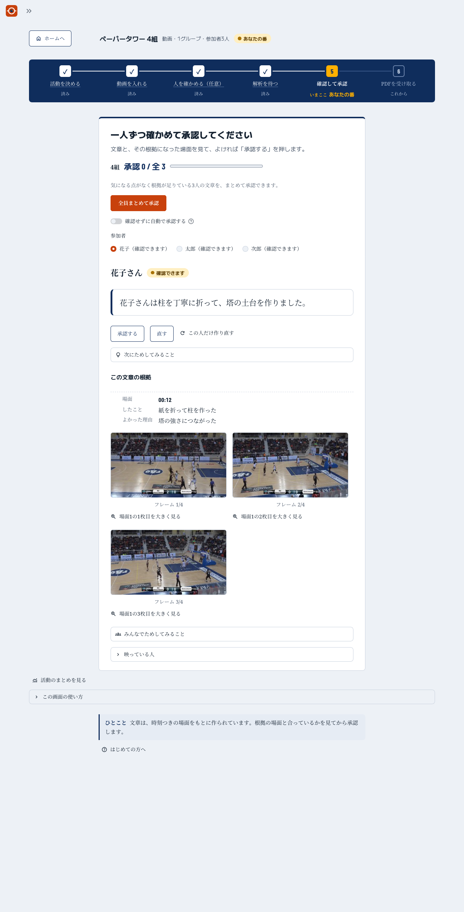
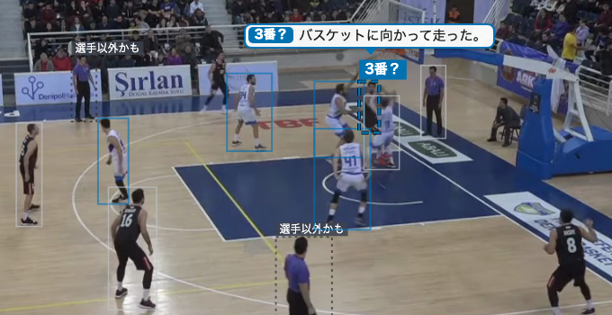

# NiceMill（ナイスミル）

日本語 | [English](#english)

**NiceMill** は、グループ活動や試合などの協働の動画から、ローカルのVLM（視覚言語モデル）で
個人別のポジティブ・フィードバック（よかった点を伝える文章）の**下書き**を作り、
評価する人が根拠の場面を見て確かめ、承認するソフトです。
解析も文章づくりも手元の計算機の中だけで行い、映像を外部のサービスへ送りません。

> **状態：公開準備中のスナップショットです。** ライセンスは未定です（下記）。
> 動画・データ・モデルの重みは含みません。人物の追跡を行う「エンジン」（別のコード）も含まれないため、
> **このリポジトリだけでは、動画から文章までの処理を最後まで動かせません**（「限界」の1を参照）。

## 関連する発表

- 題目：ローカルVLMを用いた協働インタラクション動画からのポジティブ・フィードバック生成
- 著者：濱田 怜央，酒造 正樹（湘南工科大学）
- 第17回対話システムシンポジウム ポスター No.37

## 使い方の流れ

1. 動画を登録する（評価する人）
2. AI（ローカルのVLM）が下書きを作る
3. 評価する人が、根拠の場面を見て1人ずつ確認し、承認する
4. 承認した文を、参加者に渡すPDFにする



*名前（花子など）と文は架空の例です。根拠の画像は、公開クリップ（Samsunspor 対 Merkezefendi Belediyesi Denizli Basket、TBF、CC BY 3.0、切り出し）で、文の内容とは関係ありません。画面の「確認せずに自動で承認する」スイッチは、既定ではオフです。*

画面の流れは「動画の中身 → 動画 → 人を確かめる（任意） → 解析を待つ → 確認して承認 → PDFを受け取る」です。
人が承認した文だけが、渡すPDFに入ります。



*公開クリップ（TBF、CC BY 3.0、切り出し・枠と文字の重ね書き）。*

## 特徴

- **データが外に出ない**：ローカル実行です。クラウドのAPIは使いません。外部への通信の設定を持たず、
  推論サーバーは同じ計算機（localhost）の宛先だけを受け付けます（`src/pfb_app/ops/offline.py`）。
- **根拠の場面を見られる**：文ごとに、元になった場面を確認できます。
- **人が最終確認する**：AIの出力は下書きです。承認した文だけが、渡すPDFに入ります。
- **人物の取り違えに慎重**：人物は追跡で固定し、AIには「この番号の人が何をしたか」だけを聞きます。
  背番号は「3番？」のように疑問符つきで表示します。確信が足りない動作の断定は弱めて「要確認」を付けます。
- 肯定的な内容だけを扱い、人の順位づけや比較はしません。

## 仕組みの概要

人物を追跡して匿名ラベル（P1…Pn）を付け、窓ごとの画像に番号と枠を描いて、VLM に行動の記録を出させます。
続いて、貢献の判定、根拠の選択（肯定のみ、最大3件）、文章生成を別々の呼び出しで行い、各段のあとに機械的な検査
（根拠の存在、禁止語、文の長さなど）を置きます。音声は faster-whisper で文字にします。
背番号の読み取りと、文が主張する動作の確認（姿勢と再質問の二つの手がかり）は、確信が足りなければ断定をやめます。

| 段 | 役目 | 主なコード |
|---|---|---|
| 画面 | 登録、確認、承認、PDF | `src/pfb_app/ui/` |
| ワーカー | ジョブの実行、GPUの空きの監視 | `src/pfb_app/worker/` |
| 追跡・背番号・行動記録 | 別のエンジンをサブプロセスで呼ぶ | `src/pfb_app/engine/` |
| 貢献・根拠・文章・検査 | VLM への問い合わせと検査 | `src/pfb_app/pipeline/` |
| 振り返りプレーヤー | 根拠の場面を人ごとに見返す | `src/pfb_app/review_video/` |

設計・使い方の詳細は `docs/` を参照してください（`docs/user_guide.md`、`docs/review_video.md` など。日本語）。

## この公開版に入っているもの

元にしたのは、研究室内の開発版です。研究室内で試用している版（rel8）の変更をすべて含み、その上に、開発版にだけある変更が24コミット載っています。
どちらも研究・試作の段階で、教育や競技の現場に導入済みという意味ではありません。
次の二つに分かれます。

**研究室内の試用版（rel8）に含まれる機能**：動画の登録、人物の確認、解析、確認と承認の画面、PDF出力、
やさしい文章版、練習のヒント、運用（バックアップ・監視）、アカウント。

**開発版にだけ含まれる機能（試用版にはまだ入っていません）**：振り返りプレーヤーとハイライト動画
（人ごとの色、吹き出し、チーム別の枠、全員の評価文、背番号の表示、コートの登録とコート外の人の表示）、
動作の確認（`claim_check`）、名前のない検出の枠（`extra_boxes`）。

**入っていないもの**：
- 人物の追跡・背番号・行動記録を行うエンジン（別のコード。未公開）
- 姿勢・ボール検出・動作の確認の手がかりを作る道具（AGPL-3.0 の ultralytics に依存するため）
- 動画、データベース、評価の結果、画像、モデルの重み
- 開発の途中の別ブランチの最新の修正（`ux-20261118`、`recall-20261118`、`claims-20261118` の各1〜2コミット。
  それぞれの主な機能は、上の開発版に統合済み）
- 研究室内の結合テストと計測のスクリプト（特定の機器とデータが前提のため）

## インストールと試し方（データなし）

Python 3.10 が必要です。GPU もモデルも動画も要りません。

```bash
python3.10 -m venv .venv && . .venv/bin/activate
pip install -r requirements-test.txt     # テストと画面を動かすための軽い依存だけ
pytest -q                                # テストは自作の合成データだけを使います（約16分）
```

- WeasyPrint（PDF出力）には Pango のライブラリが要ります（Linux：`libpango-1.0-0`。macOS は `brew install pango`）。
  無いと、PDF関係のテストを含め多くのテストが読み込みの段階で止まります。
- 画面だけを起動して見る：

```bash
printf 'data_dir: ./data\ninbox_dir: ./inbox\nauth_enabled: false\n' > /tmp/nicemill.yaml
PYTHONPATH=src PFB_CONFIG=/tmp/nicemill.yaml streamlit run src/pfb_app/ui/serve.py \
  --server.address 127.0.0.1 --server.port 8501
```

  ブラウザで `http://127.0.0.1:8501` を開くと、ホームと登録の画面が開きます。
  `auth_enabled: false` は、手元の確認用です（ログインなしで、この計算機から届く要求だけを通します）。
  複数人で使うときは、`docs/accounts.md` を読んで、ログインを有効にしてください。
- 設定の例：`config/settings.example.yaml`（実機の値は入っていません）。
- フルの構成（GPU、vLLM、PyTorch、エンジン）の依存は `pyproject.toml` に書いてあります
  （`uv sync`。CUDA 12.9 向けの PyTorch と vLLM を使います）。

### 公開クリップで動画から文章までを試すには

エンジンと GPU が要ります（上記のとおり、エンジンはこのリポジトリに含まれません）。
試す素材は、公開の動画だけにしてください。

- Wikimedia Commons の「Merkezefendi Belediyesi Denizli Basket - Samsunspor (24.01.20)」（TBF、CC BY 3.0）。
  冒頭60秒を再エンコードなしで切り出せます：`ffmpeg -ss 0 -t 60 -i 取得した動画 -c copy clip60.webm`
- 動画は Git に入れないでください（`.gitignore` で `*.mp4`、`*.webm` などを除いています）。
- エンジンの準備の手順は `docs/pfb3x3_engine.md` と `scripts/setup_pfb3x3_engine.sh` にあります。
  エンジンが公開されるまでは、この手順は再現できません。

### テストの結果（公開版、新しい仮想環境、データなし）

2026-11-19、Linux（Ubuntu、Python 3.10）で、新しい仮想環境に `requirements-test.txt` だけを入れて実行：
**全件が通り、スキップ 1 件、失敗 0**（約16分、GPU なし、モデルなし、動画なし）。この結果は Linux で確認したもので、macOS では未確認です。
スキップの1件は、実行環境に依存するもの（ブラウザの自動操作が要る試験は、ブラウザがなければ飛ばします。
`/proc` を使う試験は Linux 専用です）。

- テストは、**Linux での実行を前提**にしています。macOS では Pango が無いと多くが読み込みで止まり、
  `/proc` を使う一部の試験は飛ばされます（macOS での全件の確認はしていません）。
- ブラウザの自動操作の試験（Chrome、Firefox）は、それらがあるときだけ実行されます。
- 空きディスクを調べる機能の影響を受けないよう、テストは空きディスクが十分にある前提で動きます（`tests/conftest.py`）。
- データが必要で通らない試験はありません。動画・実データ・GPU・モデルを使う試験は、公開版に含めていません
  （研究室内の結合テストは削除済み。エンジンは偽物 `tests/fakes/fake_engine.py` で代用）。

## 限界

1. **処理を最後まで動かせない**：追跡・背番号・行動記録のエンジンは別のコードで、まだ公開していません。
   エンジンなしでは、画面の起動、テスト（エンジンの代わりの偽物を使う）、各部品の確認までです。
2. **生成した文の正しさの定量評価は未実施**：パス・シュートなどが本当に起きたかの評価は、少数の手採点だけです。
   専門家による参照や、人手の内容対応の評価もありません。
3. **背番号は精度の基準に届いていません**：画面では常に「N番？」と疑問符つきで表示し、名前の提案には使いません。
4. **動作の確認**は5種類の動作（シュート・ドリブル・パス・守り・走る）に限られ、正しい文を残す率は未測定です。研究室内の試用版にも入っていません。
5. **人物の取り違え**：追跡は、カメラの切り替えや混雑で別の人に移ることがあります。
   「別の人かも」の印が無いことは、別人でないという意味ではありません。取り違えの発生率の全体像は測っていません。
6. **姿勢・ボール検出・動作の確認の手がかり作りの道具は、AGPL-3.0 の ultralytics に依存するため、このリポジトリには含めていません**。
   振り返りプレーヤーの `--pose-file`・`--ball`・`--claim-cues` は任意で、ファイルが無ければその機能は無効になります。
   同じ理由で、動作の確認（`claim_check`）の手がかりも、道具を別に用意しないと使えません。
7. **無名の枠**は、描画の上で人物を補うためのもので、文章の根拠にはなりません。
8. **評価の規模が小さい**：公開クリップの標本は小さく、他の会場・カメラ・競技への一般化は確かめていません。
   評価する人の判断が実際に変わったか（利用者研究）も未実施です。
9. **再現性**：温度0でも、vLLM の連続バッチ処理では出力が完全には再現されません。
10. **やさしい文章版**の検査は機械検査のみです。
11. 撮影・研究利用の同意、倫理審査の状況：**現在確認中**です。この文書は、それらが済んでいるとは述べていません。

## プライバシーとデータの扱い

- 動画・画像・データベース・生成した文は、すべて使う人の計算機の中に置かれます。このリポジトリには含まれません。
- クラウドの生成AIのAPIは使いません。モデルは手元に置き、ネットワークからの取得は設定で止めています。
- 人物には匿名のラベルを付けます。名簿に名前を入れるかどうかは、使う人が決めます。
- 他人が写る動画を扱うときは、撮影・利用の同意と、所属機関の規則に従ってください。
  同意の記録を残す欄が画面にあります（任意）。
- バグの報告や質問に、動画・画像・人名を添付しないでください。

## 第三者のソフトウェアとライセンス

- **このリポジトリのライセンスは、未定です。** ライセンスが付くまでは、すべての権利は著者にあります。
- 依存ライブラリ、モデルの重み、フォントのライセンスは `THIRD_PARTY_NOTICES.md` と `docs/THIRD_PARTY.md` にあります。
  特に、エンジンが使う Ultralytics（YOLO11）は AGPL-3.0 です。

## 出典（画像・動画）

- 使ってよい素材は、公開のクリップだけです。
  - Samsunspor 対 Merkezefendi Belediyesi Denizli Basket（TBF、Wikimedia Commons、[CC BY 3.0](https://creativecommons.org/licenses/by/3.0/)）
  - 車いすバスケットボールの動画（Splash tv、Wikimedia Commons、[CC BY-SA 4.0](https://creativecommons.org/licenses/by-sa/4.0/)）
- `docs/images/nicemill_approve.png` の根拠の画像も、上の1本目のクリップから切り出したものです（CC BY 3.0、作者 TBF、改変あり）。画面の名前と文は架空です。
- `docs/images/review_player_public_clip.png` は、上の1本目のクリップから切り出して、枠や文字を重ねたものです（CC BY 3.0、作者 TBF、改変あり）。
- このリポジトリの `docs/court_reg/samsunspor_tbf.json` は、上の1本目のクリップの上で測ったコートの登録です。
- 画面や動画の例を載せるときは、出典（作者・ライセンス・変更の有無）を添えてください。

## 引用

`CITATION.cff` を参照してください（論文の掲載先は未定です）。

> 濱田 怜央，酒造 正樹：ローカルVLMを用いた協働インタラクション動画からのポジティブ・フィードバック生成，
> 第17回対話システムシンポジウム ポスター No.37，湘南工科大学.

---

# English

**NiceMill** is software that drafts personalized positive-feedback texts from collaborative-interaction videos
(group activities, games) with a local vision-language model (VLM). The person who evaluates then checks the scenes
that each text is based on and approves it. Analysis and text generation run entirely on local machines; videos are
not sent to external services.

> **Status: a snapshot in preparation for release. The license is undecided.**
> It contains no videos, data or model weights. The tracking "engine" (a separate code base) is not included either,
> so **this repository alone cannot run the pipeline from a video to the texts** (see Limitations, item 1).

## Related presentation

- Title: Positive Feedback Generation from Collaborative Interaction Videos Using Local Vision-Language Models
  (Japanese title: ローカルVLMを用いた協働インタラクション動画からのポジティブ・フィードバック生成)
- Authors: Reo Hamada (濱田 怜央), Masaki Shuzo (酒造 正樹), Shonan Institute of Technology
- Poster No. 37, the 17th Dialogue System Symposium

## Workflow

1. The evaluator registers a video.
2. The local VLM drafts the texts.
3. The evaluator reviews the evidence scenes one person at a time and approves.
4. Approved texts are put into a PDF to hand to the participants.

## Features

- **Data stays local**: no cloud APIs; the inference server accepts localhost destinations only.
- **Evidence scenes**: every text can be checked against the scene it came from.
- **A human gives the final check**: only approved texts go into the PDF.
- **Careful about identity mix-ups**: people are fixed by tracking, and the VLM is only asked what person number N did.
  Jersey numbers are shown with a question mark such as "#3?". Action sentences that are not sufficiently supported are
  weakened and marked "needs checking".
- Positive content only; no ranking or comparison of people.

## How it works (summary)

People are tracked and given anonymous labels (P1...Pn). Window images are drawn with numbers and boxes, and the VLM
writes an action record. Contribution judgment, evidence selection (positive only, at most 3) and text generation are
separate calls, each followed by mechanical checks. Speech is transcribed with faster-whisper. Jersey-number reading and
the check of the actions that a sentence claims (pose cues plus a second model question) withhold the assertion when
confidence is insufficient.

## What this snapshot contains

Source: the lab's internal development version, which contains everything in the lab's internal trial version (rel8)
plus 24 commits that exist only in the development version. Both are at the research/prototype stage; this does not mean
the software has been deployed in schools or sports settings.

- **In the internal trial version (up to rel8)**: video registration, people check, analysis, review/approval screens, PDF output,
  plain-language version, practice tips, operations (backup, monitoring), accounts.
- **Development-version-only features**: the review player and highlight videos (per-person colours,
  speech bubbles, team grouping, texts for everyone, jersey-number labels, court registration and marking of people
  outside the court), the action-claim check (`claim_check`), and boxes for unnamed detections (`extra_boxes`).
- **Not included**: the tracking/jersey/behavior engine (separate, unpublished); the tools that make pose, ball and action-check cue files (they depend on AGPL-3.0 ultralytics); videos, databases, evaluation results,
  images, model weights; the latest 1-2 commits of three side branches (their main features are integrated);
  lab-specific integration and benchmark scripts.

## Install and try (no data)

Python 3.10 is required. No GPU, model or video is needed.

```bash
python3.10 -m venv .venv && . .venv/bin/activate
pip install -r requirements-test.txt
pytest -q                      # uses synthetic data only
```

WeasyPrint needs the Pango library (Linux: `libpango-1.0-0`; macOS: `brew install pango`); without it most tests stop at import time.
To start only the screens, see the Japanese section above (`auth_enabled: false` is for local checks only).
The full stack (GPU, vLLM, PyTorch, engine) is listed in `pyproject.toml`. Running a video end to end requires the
engine, which is not part of this repository.

For trials use public clips only (Samsunspor TBF, CC BY 3.0; wheelchair basketball by Splash tv, CC BY-SA 4.0, both on
Wikimedia Commons), and never commit videos to Git.

## Limitations

1. The pipeline cannot be run end to end from this repository (the engine is not included).
2. The correctness of generated sentences has not been evaluated quantitatively (only a small hand-scored sample).
3. Jersey-number reading does not meet the accuracy criterion; it is always shown as "#N?" and not used to suggest names.
4. The action check covers five kinds of actions; its rate of keeping correct sentences is unmeasured; it is not in the internal trial version either.
5. Tracking can switch people under camera cuts or crowding; the absence of a "maybe another person" mark does not mean the
   person is right. The overall mix-up rate is unmeasured.
6. The tools that produce pose, ball-detection and action-check cues depend on ultralytics (AGPL-3.0) and are not included
   in this repository; the corresponding options of the review player are optional and the features are off without the files.
7. Unnamed boxes only complete the drawing; they are not evidence for a sentence.
8. The public-clip sample is small; generalization to other venues, cameras and sports, and any user study, are not done.
9. Outputs are not bit-reproducible even at temperature 0 (continuous batching in vLLM).
10. The plain-language version is checked mechanically only.
11. Consent for recording / research use and ethics review: **currently being confirmed**. Nothing here states that they are complete.

## Privacy and data

Videos, images, databases and generated texts stay on the user's machine and are not part of this repository. No cloud
generative-AI API is used. Please follow consent requirements and your institution's rules when handling videos of
people, and do not attach videos, images or personal names to bug reports.

## Third-party software and license

**The license of this repository is undecided**; until one is added, all rights are reserved by the authors. See
`THIRD_PARTY_NOTICES.md` and `docs/THIRD_PARTY.md` for dependencies, model weights and fonts (note: Ultralytics YOLO11,
used by the engine, is AGPL-3.0).

## Credits

Public clips only: Samsunspor vs. Merkezefendi Belediyesi Denizli Basket (TBF, Wikimedia Commons, CC BY 3.0); wheelchair
basketball (Splash tv, Wikimedia Commons, CC BY-SA 4.0).

## Citation

See `CITATION.cff` (venue of the paper: to be decided).
